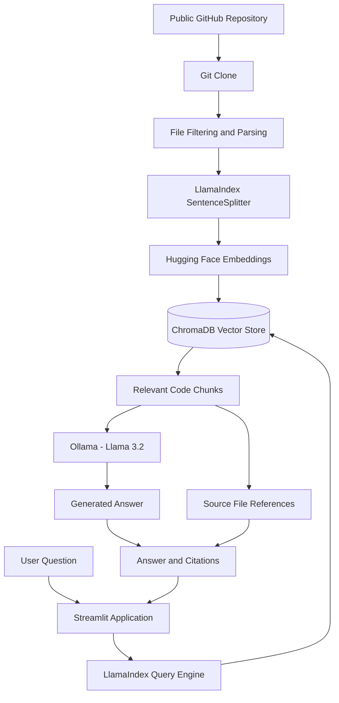

# &#x20;GitHub RAG Assistant

**An AI-powered codebase exploration tool that lets developers understand public GitHub repositories using natural-language questions and source-grounded answers.**

Explore unfamiliar codebases, retrieve relevant source files, and understand project architecture using Retrieval-Augmented Generation (RAG).


\


---

## 🚀 Overview

GitHub RAG Assistant converts a public GitHub repository into a searchable knowledge base.

Instead of manually navigating multiple source files, developers can ask questions such as:

- Explain the architecture of this repository.
- Which function handles repository ingestion?
- How are embeddings generated and stored?
- Explain how a particular function works.
- Which files implement the retrieval pipeline?

The application retrieves relevant code chunks from a ChromaDB vector store and uses a locally running LLM to generate answers with clickable source-file references.

## ✨ Features

- **GitHub Repository Ingestion:** Clones public repositories using shallow Git cloning.
- **File-Aware Processing:** Extracts supported source files while retaining file paths and GitHub source URLs.
- **Semantic Search:** Generates embeddings using Hugging Face Sentence Transformers.
- **Vector Database:** Stores and retrieves document embeddings using persistent ChromaDB.
- **AI-Powered Answers:** Uses LlamaIndex and Ollama to generate context-grounded responses.
- **Source Attribution:** Displays retrieved source files and similarity scores.
- **Interactive Dashboard:** Streamlit interface with repository indexing, chat history and response-time measurement.
- **Retrieval Evaluation:** Includes Precision\@K, Recall\@K and Mean Reciprocal Rank (MRR) metrics.

## 🏗️ Architecture



### Query and ingestion pipeline

| Component                        | Responsibility                                      |
| -------------------------------- | --------------------------------------------------- |
| `app.py`                         | Streamlit interface and user interaction            |
| `src/ingestion/github_loader.py` | Git cloning, file filtering and document extraction |
| `src/retrieval/vector_store.py`  | Chunking, ChromaDB storage and index creation       |
| `src/generation/llm.py`          | Embedding and LLM configuration                     |
| `src/pipeline.py`                | Index construction and question-answering pipeline  |
| `src/config.py`                  | Application and model configuration                 |
| `evaluate_retrieval.py`          | Retrieval benchmark execution                       |

## 🛠️ Technology Stack

| Category         | Technologies                       |
| ---------------- | ---------------------------------- |
| Language         | Python                             |
| Frontend         | Streamlit                          |
| RAG Framework    | LlamaIndex                         |
| Embedding Model  | BAAI/bge-small-en-v1.5             |
| Vector Database  | ChromaDB                           |
| Language Model   | Llama 3.2 through Ollama           |
| Machine Learning | Hugging Face Sentence Transformers |
| Testing          | Pytest                             |
| Version Control  | Git and GitHub                     |

## ⚙️ Installation and Setup

### Prerequisites

- Python 3.11
- Git
- Ollama
- A local Ollama model such as `llama3.2`

### 1. Clone the repository

```bash
git clone https://github.com/Amitesh2876/github-rag-project.git
cd github-rag-project
```

### 2. Create a virtual environment

Windows PowerShell:

```powershell
py -3.11 -m venv .venv-rag
.\.venv-rag\Scripts\Activate.ps1
```

### 3. Install dependencies

```bash
python -m pip install --upgrade pip
pip install -r requirements.txt
```

### 4. Download the Ollama model

Install and start Ollama, then run:

```bash
ollama pull llama3.2
```

### 5. Launch the application

```bash
streamlit run app.py
```

Open the local Streamlit URL, enter a public GitHub repository URL, and select **Index Repository**.

## 📊 Retrieval Evaluation

The project includes a labelled retrieval test set and an evaluation script to measure how effectively the system retrieves expected source files.

Run the benchmark:

```bash
python evaluate_retrieval.py
```

Run unit tests:

```bash
python -m pytest -q
```

### Initial benchmark results

The initial seven-question evaluation produced:

| Metric                     | Result |
| -------------------------- | -----: |
| Precision\@3               |  33.3% |
| Recall\@3                  |   100% |
| Mean Reciprocal Rank (MRR) |  0.690 |
| Benchmark questions        |      7 |

**How to interpret these results:**

- Recall\@3 of 100% means the expected source file appeared within the top three results for all seven benchmark questions.
- Precision\@3 of 33.3% reflects the single-labelled-relevant-file evaluation setup.
- MRR of 0.690 measures the ranking position of the expected source file.

These are preliminary results from a small, manually labelled test set, not a general measure of answer accuracy.

### Response latency

A sample local architecture query took approximately **37.9 seconds** during development on a CPU-based configuration.

This is an individual observation, not a statistically representative average.

## 📁 Project Structure

```text
github-rag-project/
│
├── app.py
├── evaluate_retrieval.py
├── requirements.txt
├── README.md
├── .env.example
├── .gitignore
│
├── src/
│   ├── config.py
│   ├── pipeline.py
│   │
│   ├── ingestion/
│   │   └── github_loader.py
│   │
│   ├── retrieval/
│   │   └── vector_store.py
│   │
│   └── generation/
│       └── llm.py
│
└── tests/
    ├── test_github_loader.py
    └── test_rag_evaluation.py
```

## ⚠️ Limitations

- Supports public GitHub repositories; private repository authentication is not implemented.
- Requires a locally running Ollama service.
- Repository indexing is rebuilt rather than incrementally updated.
- Only supported text and source-code file types are indexed.
- Retrieval quality has only been evaluated on a small initial benchmark.
- Response latency depends on local hardware and model configuration.

## 🔮 Future Improvements

- Expand the labelled retrieval evaluation dataset.
- Improve retrieval ranking and answer faithfulness.
- Add more detailed latency measurements.
- Implement incremental repository indexing.
- Improve code-aware chunking and language-specific parsing.

## 👨‍💻 Author

**Amitesh Peachera**

B.Tech — Computer Science and Engineering

[GitHub](https://github.com/Amitesh2876) · [LinkedIn](https://www.linkedin.com/in/amitesh-peachera-667240287/)

---

*Built as a practical exploration of Retrieval-Augmented Generation, semantic search, vector databases and local LLM applications.*
